##

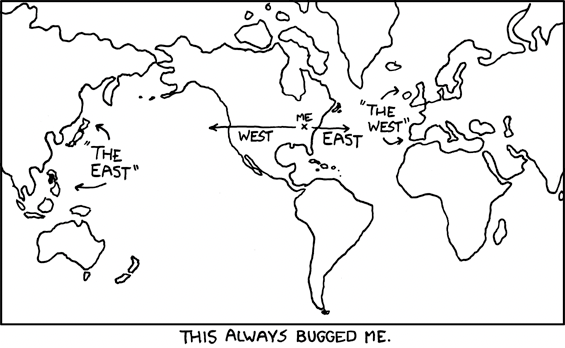{alt="xkcd comic"}

## Today's agenda

- General housekeeping: Any Questions?
- Project proposals due this week!
- Lecture: Where spatial data come from
  - Table joins
  - X, Y coordinates (should sound familiar!)
  - Spatial joins

{alt="Stork Baby outline"}

# Joining tables

## Table joins

- To "join" a table means to combine one table with another

- For example, you have a feature class of every college in the US but want to know something about these schools—public or private? How many students? You find an Excel spreadsheet that contains this information, but to associate it with the college point data, you'll need to do a "join" on the attribute table of the college layer and your spreadsheet data.
  
## Table joins

\
\

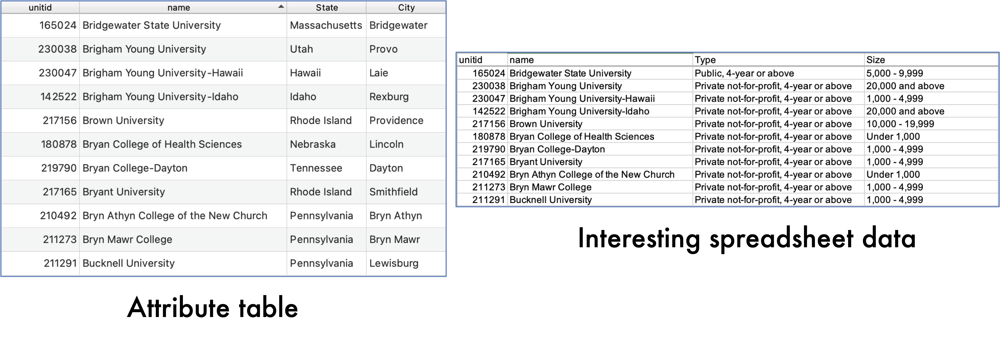{alt="Screenshot of ArcGIS Pro"}

## Table joins

- When we bring tables together, we have a **source table** and a **destination table** – one table is going to be added to the end (or appended) of the other table
  - The source table is the one providing the additional information – a standalone table
  - The destination table is the one that is going to get bigger; the one to which we're going to add information
    - This is generally the feature attribute table
    - This is the one you're right-clicking from
- Joins can be removed – this is not a permanent combination of tables
  - This means: once you join tables and are happy with result: export and create a new feature class

## Table joins

- Tables are joined based on a common attribute, or common key
  - This is how one table's information is matched to the corresponding table's
  - The column you use to join tables needs to be identical and the same data type
  - They do *not* need to have the same variable name

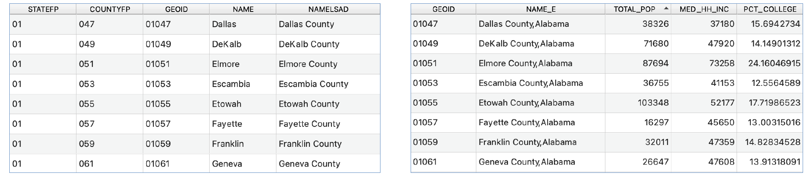{alt="Screenshot of ArcGIS Pro"}

## Table joins

- Tables are joined based on a common attribute
  - Just because you think the information is the same, does not mean the computer will think so!

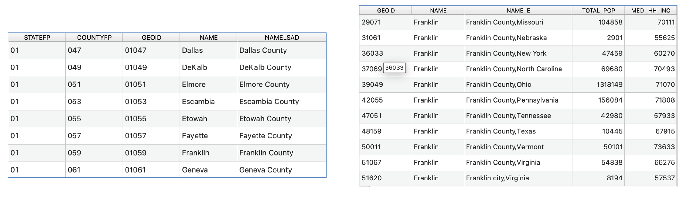{alt="Screenshot of ArcGIS Pro"}

## Table joins — troubleshooting

- Using place names to join data tables can be problematic
  - For example, Saint Louis versus St. Louis (NOT the same!)
  - Franklin County versus Franklin Co. (NOT the same!)
- If administrative place codes are available, these are the best choice
  - In the US, these are called FIPS codes
  - Most countries will have a system of codes for places
  - For joins, both variables need to be the same format (that is: text or number)
  - For US data, I recommend NHGIS for all census and GIS data
- Always check your results before proceeding!

## Cardinality {.smaller}
The relationship between records in two tables 

- Joining the attribute table of a shapefile of N colleges to a spreadsheet containing data on N colleges is what we call a "one to one" join.
- We can describe cardinality in terms of "destination" to "source"
- Rule of Joining states that the table resulting from a join can have only one record for each entity in the destination table
- We can also have:
  - Many to one --- Attaching county demographic data to college information
    - there will be more than one college in many counties
  - One to many --- Attaching college data to county data
    - This won't work, since the output table won't know which college's data to attach to each county's entry
  - Many to many --- Multiple matching records in both source and destination tables
    - We also can't join these tables
- Instead, for the latter case, we use "relates"
  - Tables are brought linked using the common key field, but are not joined---that is, there's no new output table

## Joining tables in ArcGIS Pro

::::{.columns}

:::{.column width = "40%"}

\
\

- Add csv to project
- Right click on layer you want to merge the tabular data with
- Select "Joins and Relates"
  - Add join
:::

::: {.column width = "60%"}
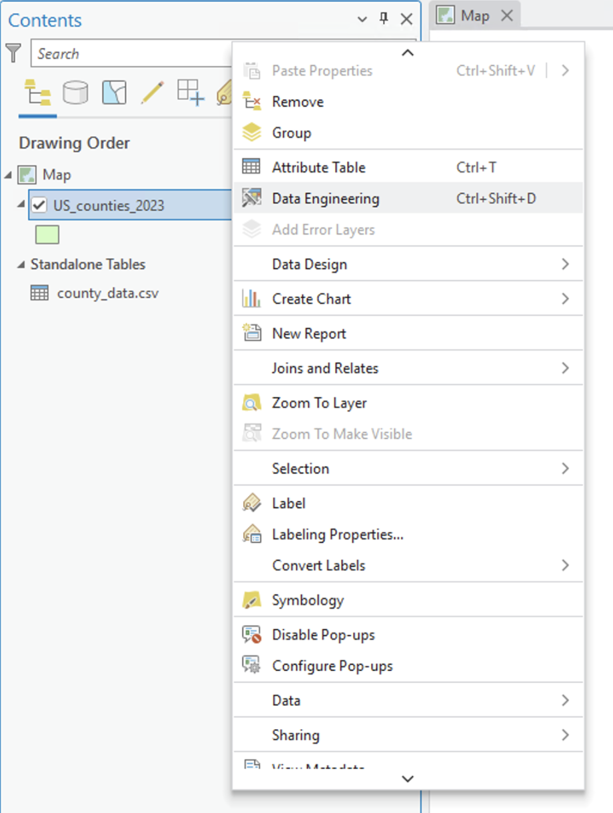{alt="Screenshot from ArcGIS Pro" width="70%"}

:::

::::

## Joining tables in ArcGIS Pro

:::: {.columns}

::: {.column width = "40%"}
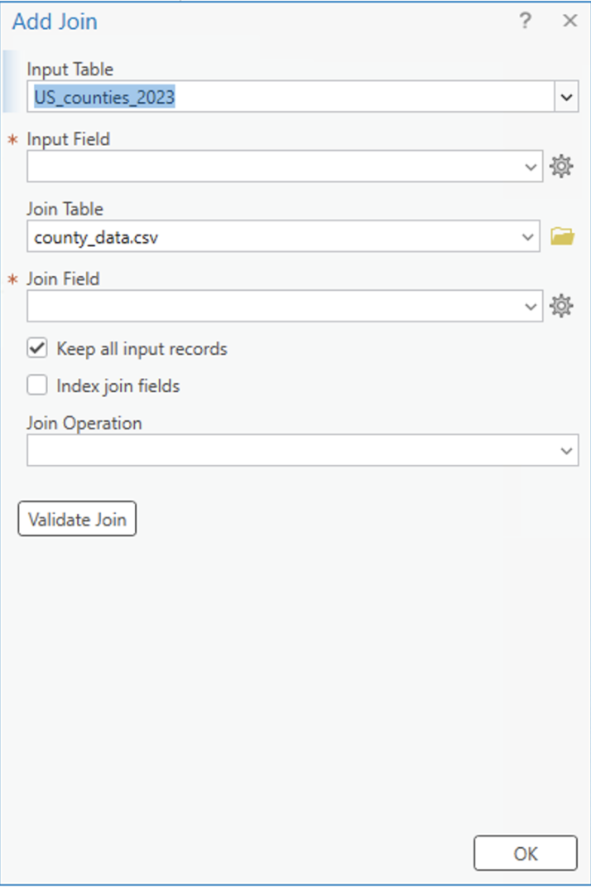{alt="Screenshot from ArcGIS Pro" width="90%"}
:::

::: {.column width = "60%"}

\

- You specify:
  - Both tables
  - Two variables that connect the tables
- Validate join
- OK
- Reminder: export and save new feature class!!

:::

::::

# Making spatial data from X, Y coordinates

## X,Y — latitude/longitude — to point

- This should be familiar from your field data collection lab
- Key reminders:
  - Start with a csv containing lat, long data
  - Know your coordinate system (e.g., WGS84 (World Geodetic System 1984 or NAD83 if only US data)
  - Use X, Y table to point to create feature class
  - Export new feature class and add a projection

##

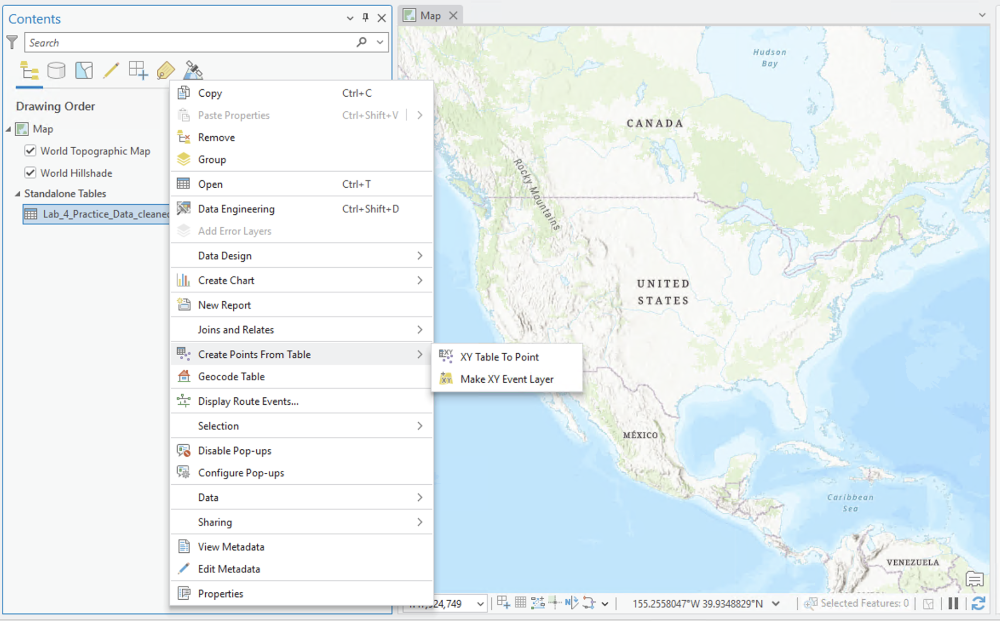{alt="Screenshot of ArcGIS Pro"}

Right click on table to get to Create Points From Table > XY Table to Point

##

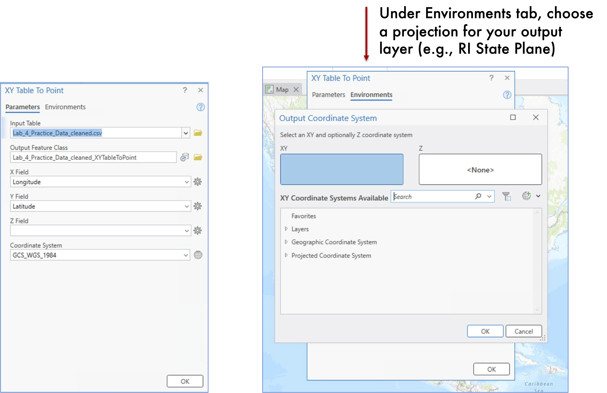{alt="Screenshot of ArcGIS Pro"}

- Choose a name for new layer; check save location
- Make sure Lat and Long fields are correct

# Spatial joins (point in polygon)

## Spatial joins

- Spatial + Join
  - Combining two feature classes based on location
  - Target and join feature classes
    - The target feature class receives the new information
    - Joins are done based on, for example:
      - Proximity – appends information for closest feature
      - Containment – adding polygon characteristics to point data, based on which polygon the point falls in
- What type of spatial join we do depends on what types of features we're working with

## Add Spatial Join

- How many big airports are in each state?
- Right click state>joins and relates>add spatial join

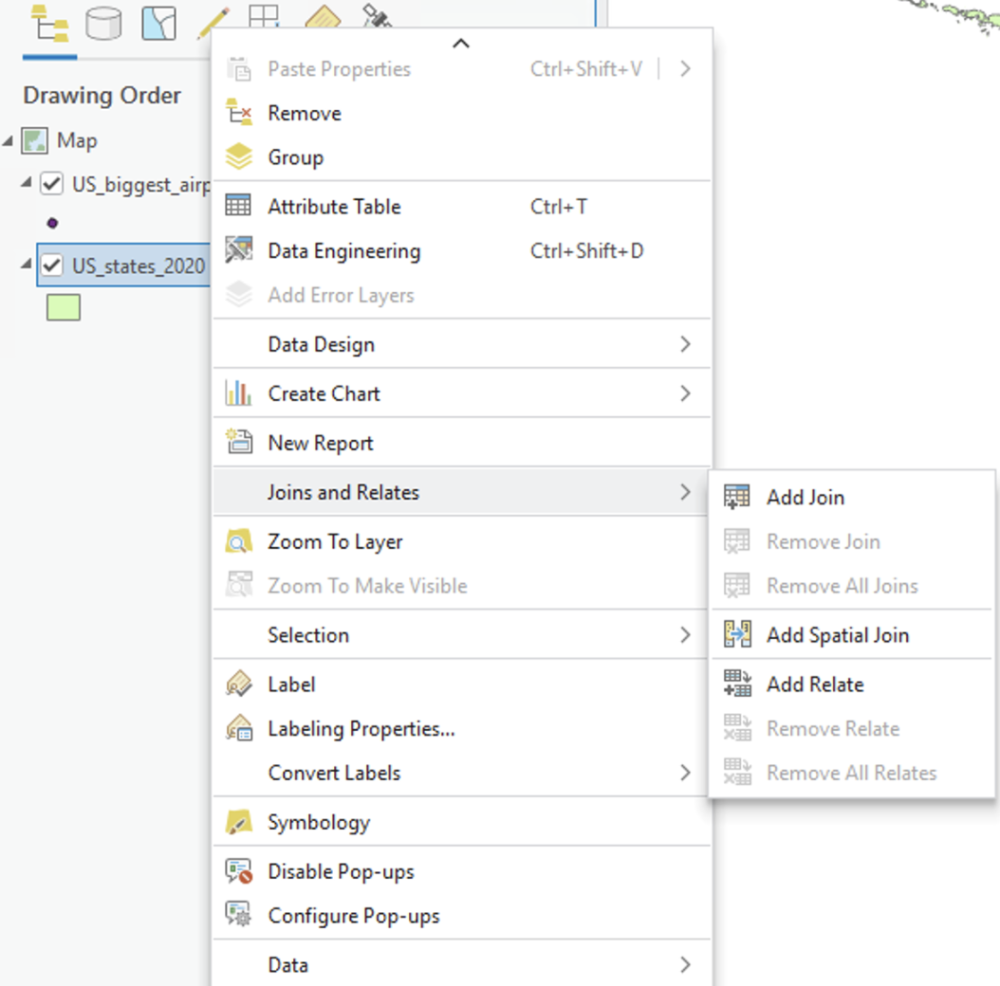{alt="Screenshot from ArcGIS Pro"}

## "Add Spatial Join"

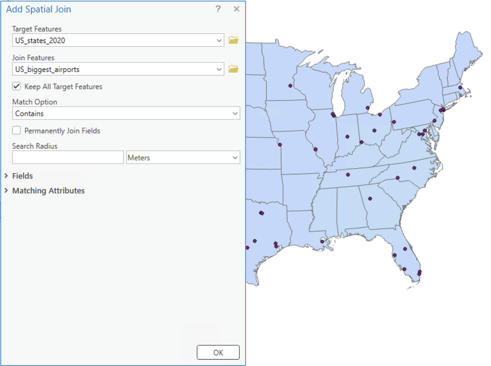{alt="Screenshot from ArcGIS Pro"}

## "Add Spatial Join"

- Lots of types of spatial relationships
- Use help!
- Spatial join is temporary

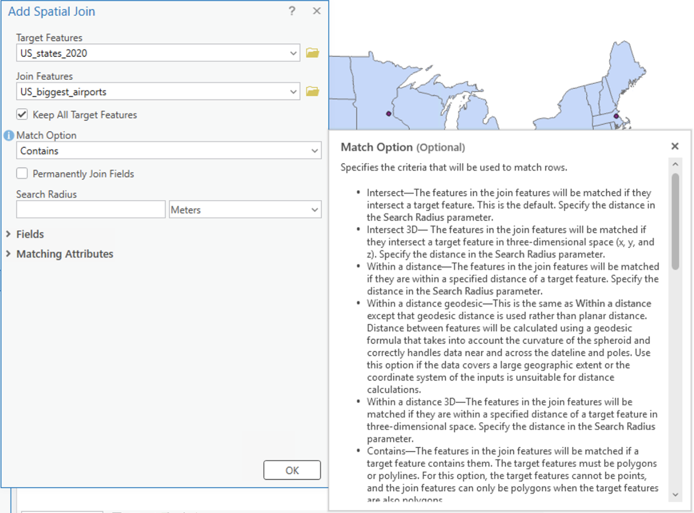{alt="Screenshot from ArcGIS Pro"}

## "Add Spatial Join"

- No new data are created
- Automatically adds a "join count" variable that tells you how many points were in each polygon
- Does not update other variables!

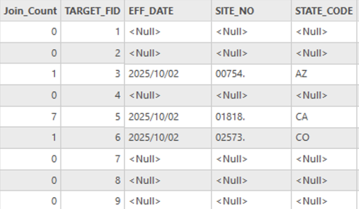{alt="Screenshot from ArcGIS Pro"}

## Spatial Joins—other options

- Under **Analysis** tab: **Spatial Join**

  - This option *does* create a brand new layer!

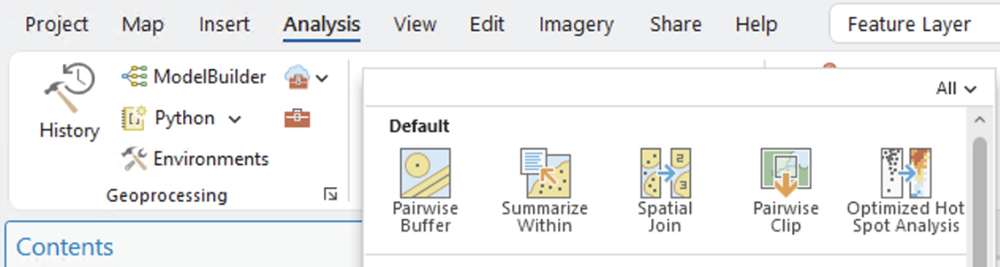{alt="Screenshot from ArcGIS Pro"}

## Spatial Joins—other options

:::: {.columns}

::: {.column width = "30%"}
- Also under **Analysis** tab:
  - **Summarize Within**: perfect for counting points in polygons and summarizing variables
  - For example, how many airports in a state plus how many passengers total

:::

::: {.column width = "70%"}

\
\

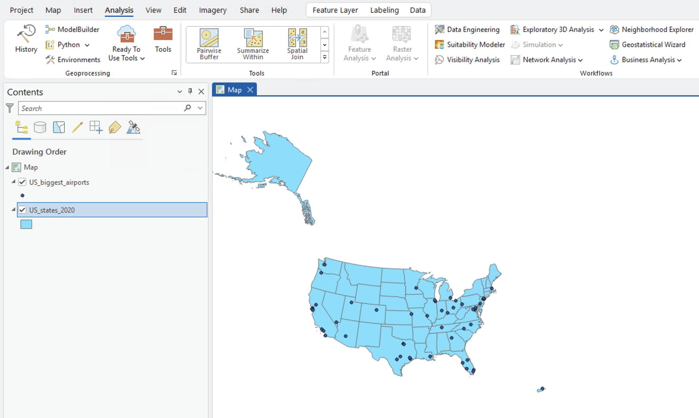{alt="Screenshot from ArcGIS Pro"}

:::

::::

## Spatial Joins---using Summarize Within

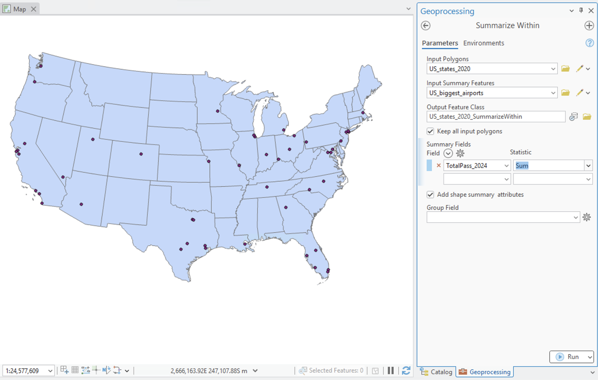{alt="Screenshot from ArcGIS Pro"}

## Spatial Joins---using Summarize Within

- Creates a new feature class
- Uses input polygon geometries

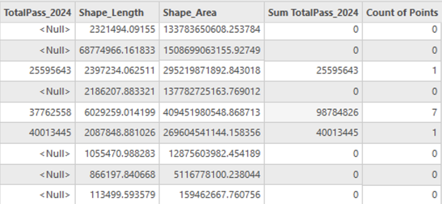{alt="Attribute table screenshot from ArcGIS Pro"}
