##

](images/image1.png){alt="xkcd comic: https://xkcd.com/2256/"}

## Today's agenda

- General housekeeping: Any Questions?
- Project Lit Reviews due **next week**!
- Lecture:
  - Where Spatial Data Come From (Part 3): Geocoding
- Geocoding practice
- In **three** weeks: Exam!

# Geocoding --- What's that?

# Geocoding --- It's this

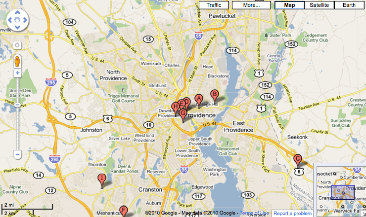{alt="Map showing points of interest"}

## Geocoding --- It's this

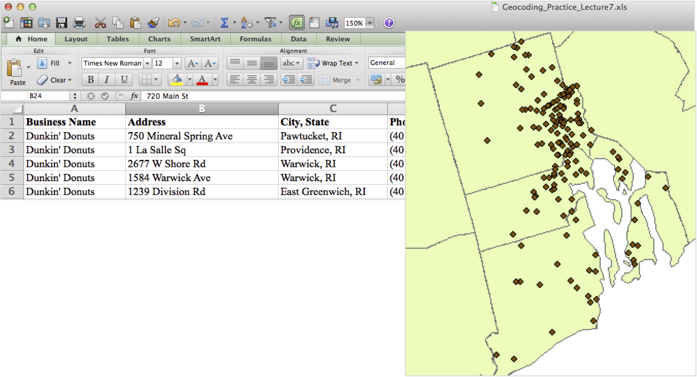{alt="Screenshot of Excel"}

## Geocoding --- It's this

- Along with mapping, geocoding is one of the most commonly-used GIS applications
- When we geocode, we attach location information to tabular geographic information
  - Locations of all grocery stores in Providence
  - Locations of all REI stores in the U.S.
  - Locations of all capital cities in the world
- We can think of a location-specificity continuum from general (e.g., cities) to specific (e.g., exact addresses)

##

- The more specific we are in terms of location, the more geographic information we need
  - Also, depending on use of geocoded information, exact location may be very important – for example, 911 emergency calls
  - Locating cities requires a reference file with city locations
  - Locating addresses in Providence requires street name and street number, at a minimum
- Locations can be attached to polygons or points, but the most challenging is attaching to addresses, or **lines**

## What's it used for?

- Emergency services
- GPS
- Driving directions
- Google maps
- Crime analysis
- Marketing

## How does it work?

- Tabular data are compared to a spatial Reference layer
  - This is what ArcGIS Pro uses to match addresses
- This happens in a few steps
  - To work best, addresses need to be recognizable to the computer, or standardized
  - Then standardized addresses in our table of locations (say, Urban Outfitters stores) are compared to our reference layer
- To understand this, think about the standard components of a street address
  - Prefix direction
  - Street name
  - Street type
  - Number
  - Suffix direction

## Spatial Reference Layer

:::: {.columns}

::: {.column width="50%" .smaller}
- The spatial reference layer includes the spatial information that will help locate our list of places in space
  - The street name, obviously, if we're geocoding addresses
  - Or city and state
- Names of streets are attached to line segments, or polylines
  - Each line segment is associated with a range of street numbers
  - These are tabulated as "from address" to "to address" – allowing us to increase house numbers from bottom of line segment to top, since we know beginning and end number
    - What we don't know is where, exactly, a building lies on that line segment
    - So geo-coding always has an element of approximation to it
    
:::

::: {.column width="50%"}

\
\

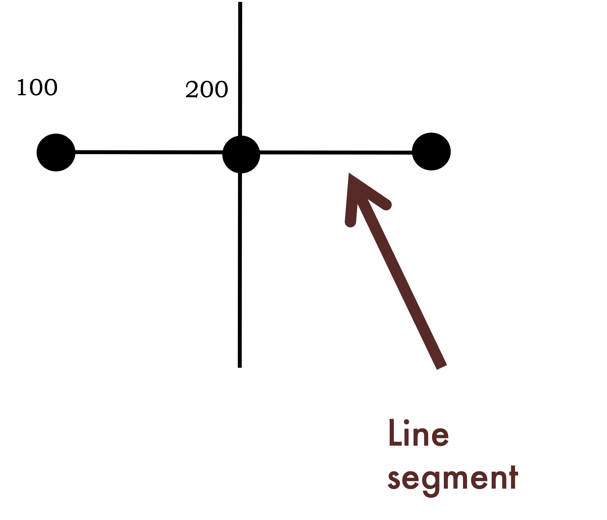{alt="diagram of streets and address ranges" fig-align="right"}

:::

::::

## Address Geocoding

- **One range method**: A single address range for each chunk of street
- **Two range method**: An address range for each side of the street
  - Obviously more desirable, but not always possible since this information needs to be coded into the reference layer
- In both cases, addresses are assigned to a place on the line in proportion to the starting and ending address on the line itself.
  - So if the polyline starts at 100 Main St. and ends at 200 Main St., an address of 150 Main St. goes right in the middle

## Types of geocoding styles

- **Single field** --- Zip code, state name, power stations
- **Alphanumeric Ranges** --- Helps narrow the search range for address identification, since ArcMap only has to look in that quadrant
- **US Cities and states** --- Locates cities, given city and state names
- **US One Address** – Matches addresses to points or polygons
- **US One Range** --- Matches addresses to one range of street values
- **US Streets** --- Matches addresses to a range of street values for both sides of the street
- **World City and country** – Locates cities within countries on a world map
- **Zip code** --- Matches zip codes to a point or polygon reference layer
- **Zone option** --- Additional pieces of information (zip, state, city) that allow us to match over larger areas

## Why it's important to know your study location

- Quirky address styles:
  - Queens, NY
  - Washington, DC
  - Phoenix, AZ
- Quickly growing locations
- Spelling quirks
  - Saint and St. / Sainte and Ste.
- Value of alias tables
  - Maxcy Hall v. 108 George Street

##

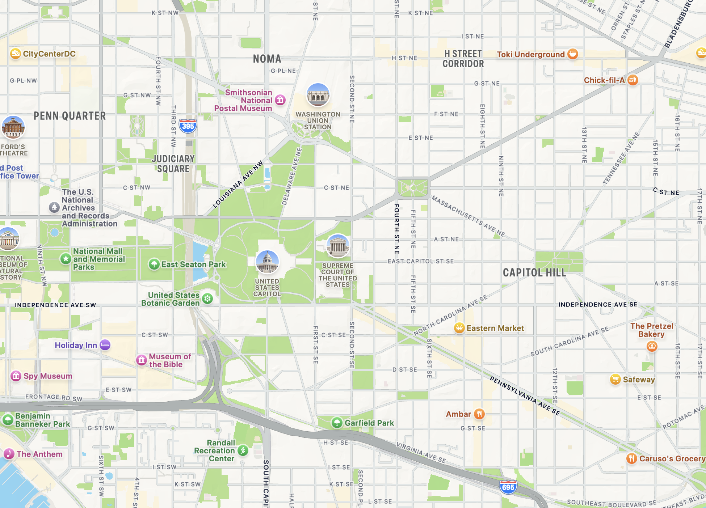{alt="Screenshot from Apple Maps of Washington DC"}

[Source: Apple Maps](#)

## Getting Data Ready to Geocode

Do we see problems here?

{alt="Screenshot of Excel"}

## Getting Data Ready to Geocode

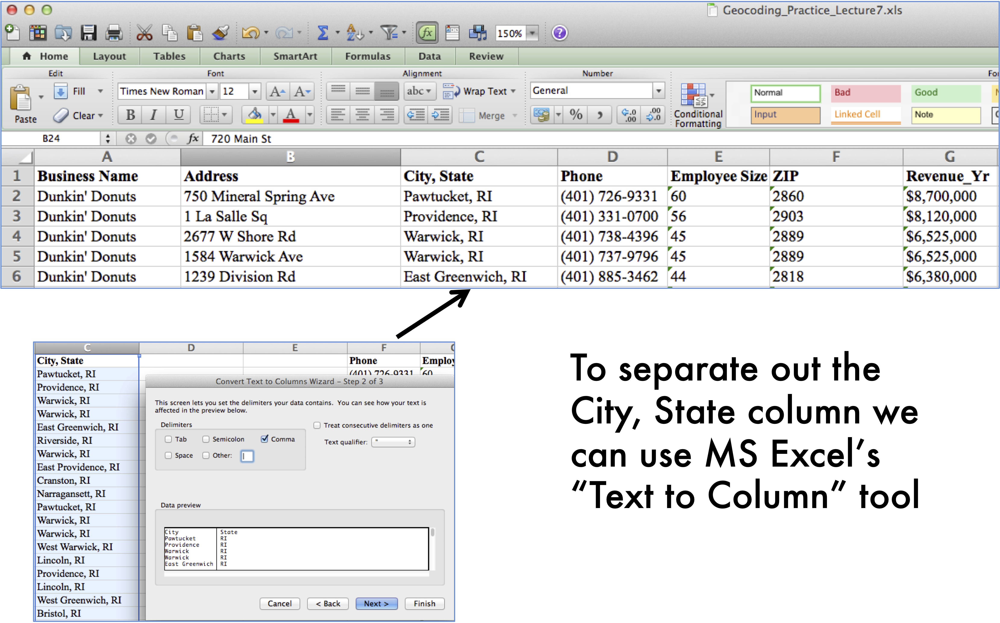{alt="Screenshot of Excel"}

## Getting Data Ready to Geocode

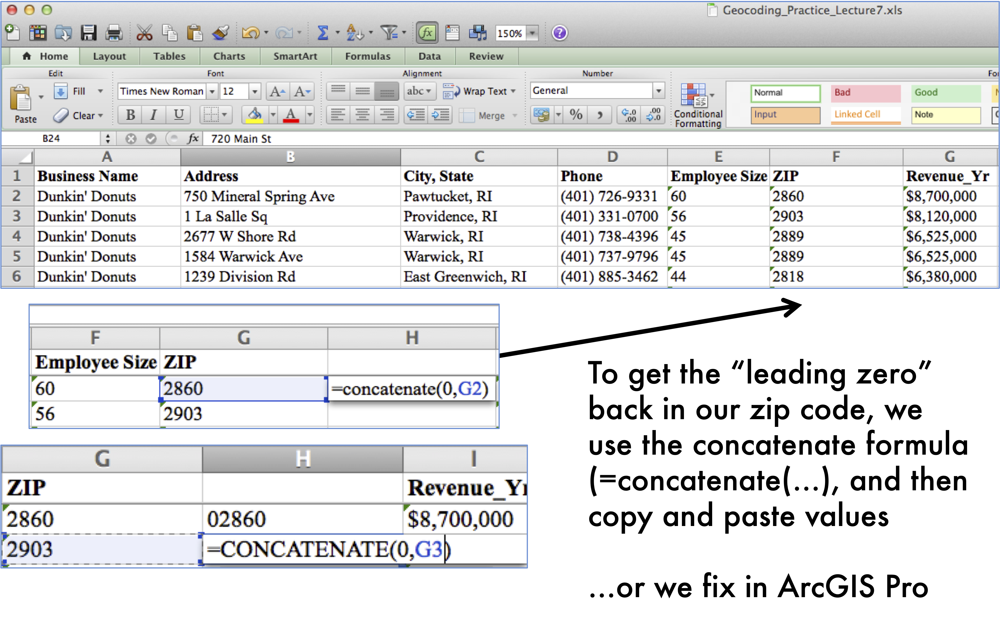{alt="Screenshot of Excel"}

## How geocoding works in ArcGIS Pro

- First, load your address table csv into ArcGIS Pro
- Then right click and choose "Geocode Table"
  - Prompts will ask you to choose a locator—be sure you're logged to ArcGIS Pro via Brown since geocoding costs "credits"
  - Locator will prompt you for the pieces of information we need in order to geocode
    - What are the key fields we'll use to locate addresses?
- The output is a new shapefile or feature class

## Geocoding overview

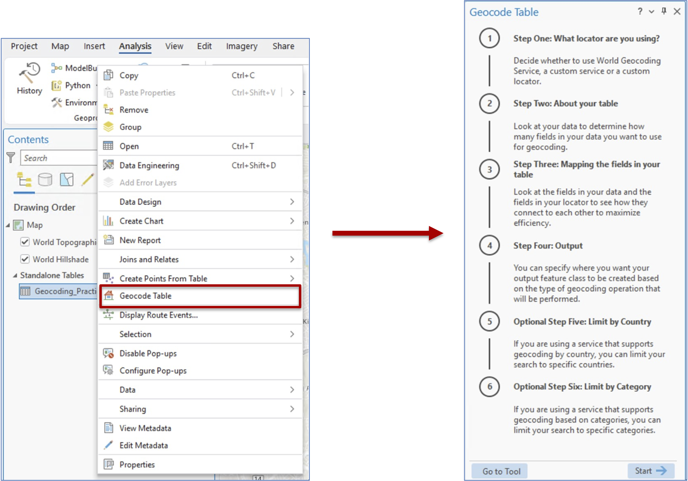{alt="Screenshot of ArcGIS Pro"}

## Geocoding overview

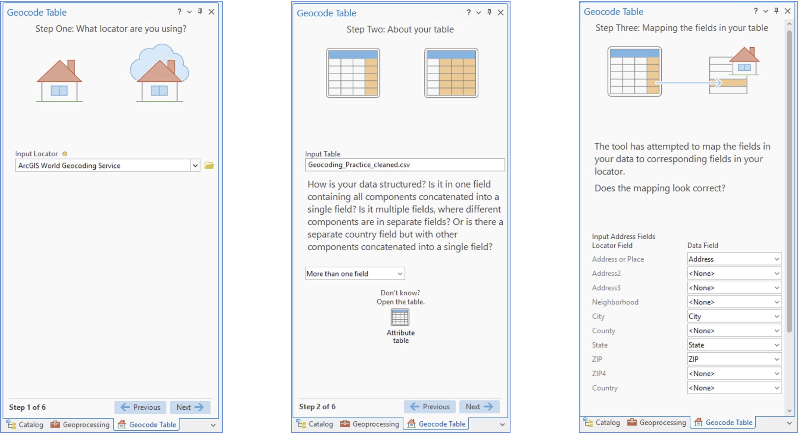{alt="Screenshot of ArcGIS Pro"}

## Geocoding overview

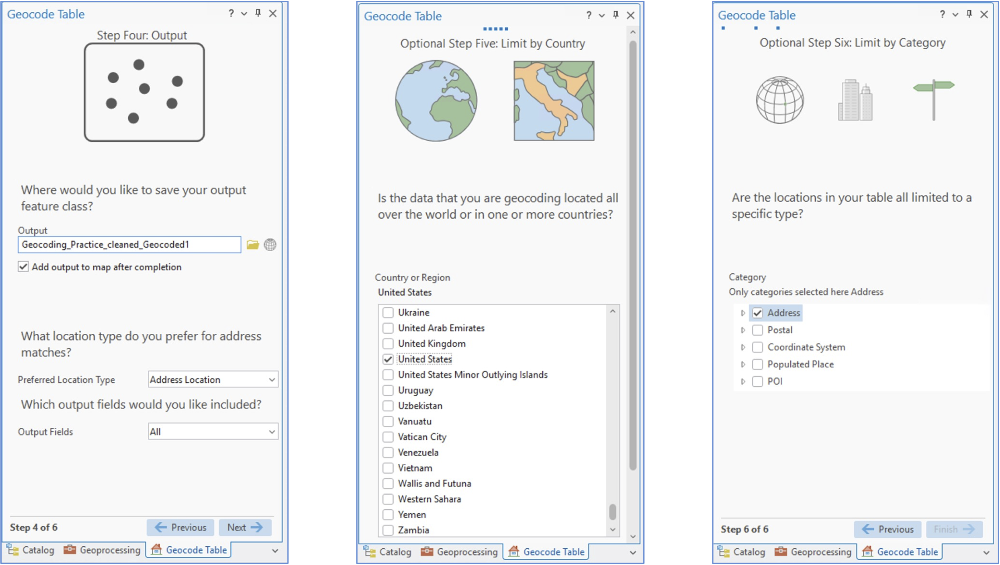{alt="Screenshot of ArcGIS Pro"}

## Geocoding overview

:::: {.columns}

::: {.column width="60%"}

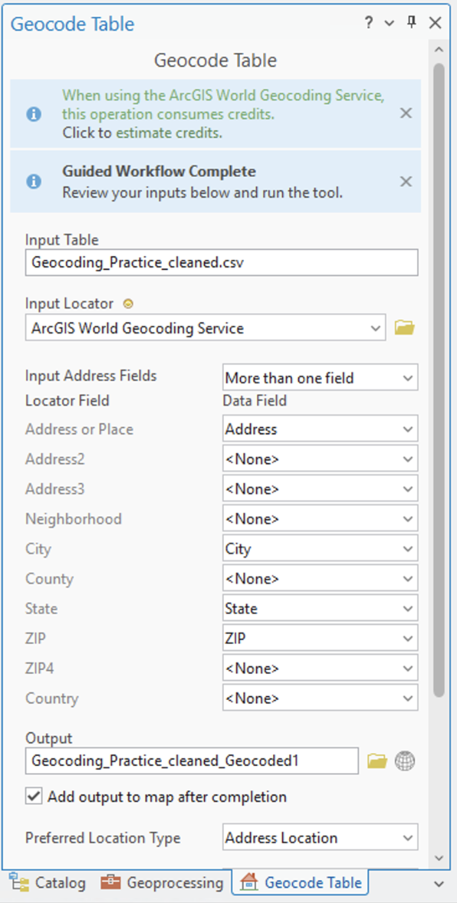{alt="Screenshot of ArcGIS Pro" width="50%"}

:::

::: {.column width="40%"}

\
\
\

Last step!

Click to estimate credits

**This is a step you ideally do only once!**

:::

::::

## Geocoding results

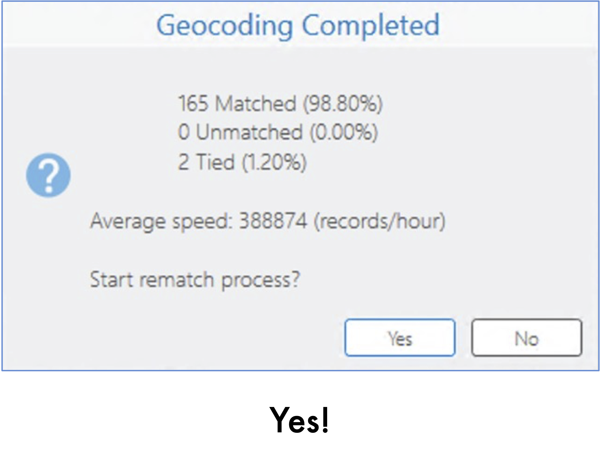{alt="Screenshot of ArcGIS Pro"}

## Geocoding results

:::: {.columns}

::: {.column width="70%"}
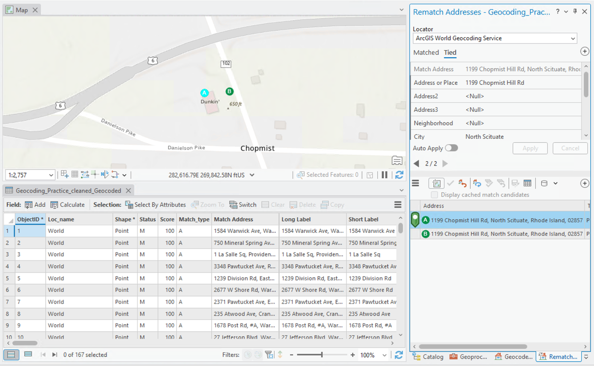{alt="Screenshot of ArcGIS Pro"}

:::

::: {.column width="30%"}

\
\
\

Important to spot check matched, unmatched, and tied!

:::

::::

## Geocoding results

:::: {.columns}

::: {.column width="70%"}
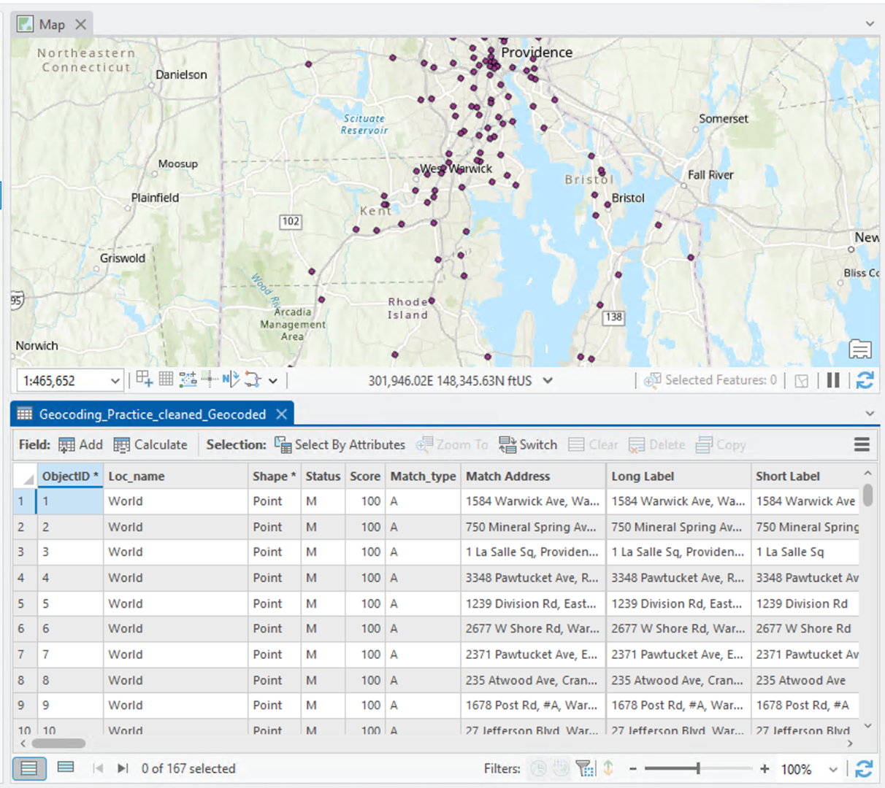{alt="Screenshot of ArcGIS Pro"}

:::

::: {.column width="30%"}

Important to spot check matched, unmatched, and tied!

:::

::::

## Summary: Geocoding in ArcGIS Pro

- Clean address data in MS Excel if necessary (be sure to close table when done, before adding to ArcGIS Pro)
- Save as csv
- Add csv standalone table containing addresses of interest.
- Select locator (exact method will depend on ArcGIS Pro license and other factors)
- Geocode, including selecting preferences
- Check non-matching addresses if necessary

## Geocoding Practice

- Extra data posted on Canvas
  - Try cleaning Excel data if you'd like the practice; otherwise use "cleaned" spreadsheet
  - Geocode!
  - If you have time, try dealing with the tied addresses (google sometimes helps)
