##

](images/image1.png){alt="xkcd comic about heatmaps"}

##

{alt="lantern fly map"}

## Today's agenda

- General housekeeping: Any Questions?
- Project Lit Review comments
- Lecture:
  - A raster reminder
  - Interpolation, kernel density, and hex maps
- Exam: Next week!!!
  - In two parts: theoretical/essay + practical

## Raster Reminder

- What are they?

## Raster Reminder

- What are they?
- Rasters are the "other spatial data model," along with vector (points, lines, and polygons)
  - Rasters are particularly useful for continuous data – surfaces like elevation or precipitation
- Rasters have coordinate systems and projections, just like the vector data model

## Important info about rasters

- They're typically complex data structures that span multiple folders
- Do not attempt to copy, move, rename, or delete grids outside of Catalog.
- Names must be 13 characters or less
- Do not use spaces or non-alphanumeric characters to name grids
- No spaces in folders or grids
  - (underscore is OK)

# Interpolation and Density Estimation

## Interpolation and Density Estimation

- Two different techniques that start and end in similar places
  - The input is a set of points
  - Output is a raster
- One commonality: these techniques are easy to apply incorrectly!

# Interpolation

## Interpolation

- Estimating, or "guessing," values for locations for which we do not have data
  - For example, elevation based on a set of sample points; we cannot reasonably sample every single location in the study area
  - In a GIS setting, this generally entails going from a set of points to a raster
  - A variety of estimation techniques exists, but underlying them all is the concept of spatial dependence
    - Remember: locations closer to each other are more likely to be related; as distance increases, this relationship becomes more tenuous

## Interpolation

:::: {.columns}
::: {.column width="40%"}
- We can impose a grid on our study area and then assign values to each cell, given our input point data information
- In the case of snowfall (right), we know snow fell in places we don't have measurements, and that amounts will vary across space
- If we had to guess, we would want to be able to borrow information from the locations where we did sample
:::

::: {.column width="60%"}
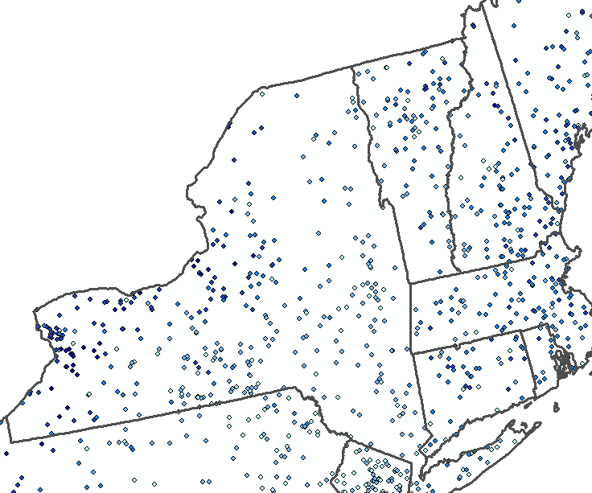{alt=""}
:::
::::

## Interpolation methods

- Common methods include:
  - Inverse Distance Weighted (IDW)
  - Kriging
  - Spline
- All are implemented in ArcGIS Pro, via Tools
- Key is to understand both the technique you're using and the data you're working with

## Inverse Distance Weighting

:::: {.columns}
::: {.column width="50%"}
- Uses values of neighboring points to estimate values for a grid cell
- Points located further away carry less weight than points close by (hence inverse distance weighting)
- Estimated cell values may not necessarily match input point values
:::

::: {.column width="50%"}

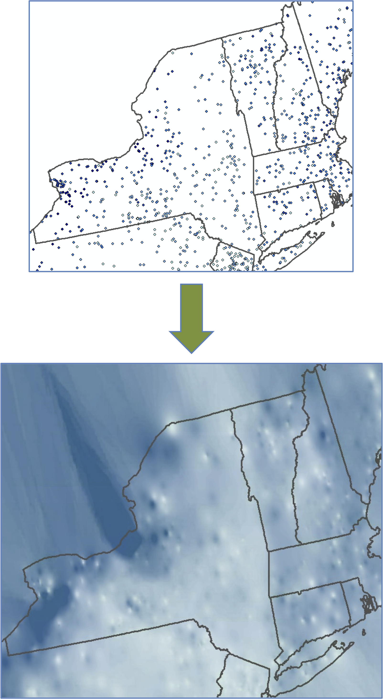{alt="snow surface" width="60%"}
:::
::::

## Kriging

:::: {.columns}
::: {.column width="50%"}
- Comes from the field of geostatistics and also leverages information from neighboring points
- But also incorporates information from underlying spatial structure or variation within data, using the semivariogram
:::
::: {.column width="50%"}
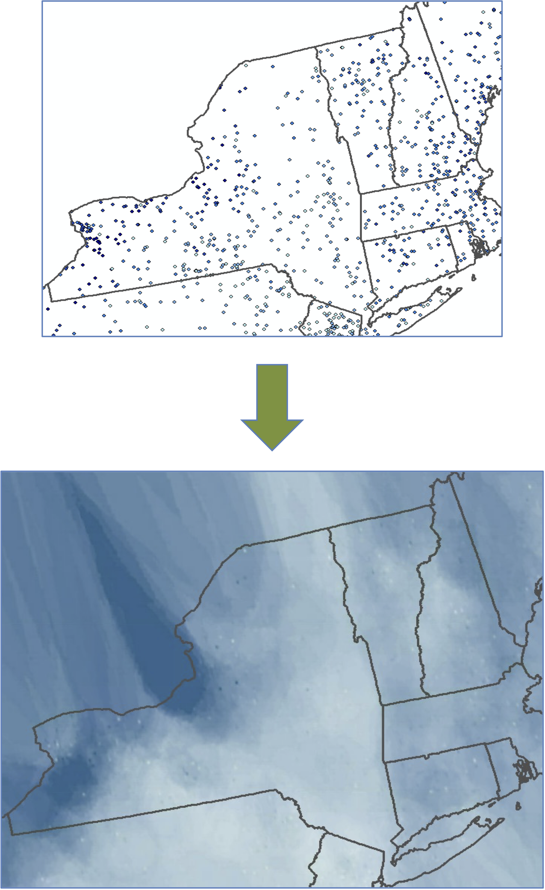{alt="snow surface" width="60%"}

:::
::::

## Spline

:::: {.columns}
::: {.column width="50%"}
- Fits a surface to the input set of points, such that the surface passes through each point value with minimum curvature
- Results in a relatively smooth surface
:::

::: {.column width="50%"}

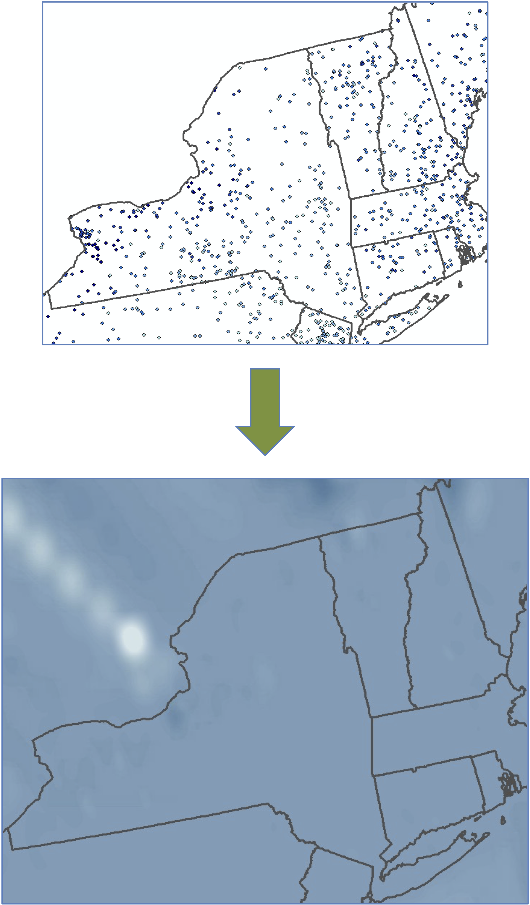{alt="snow surface" width="60%"}
:::
::::

## Things to consider

:::: {.columns}

::: {.column width="50%}
- Output cell size
- Determination of neighborhood
  - Search radius
  - Nearest neighbors

:::

::: {.column width="50%"}
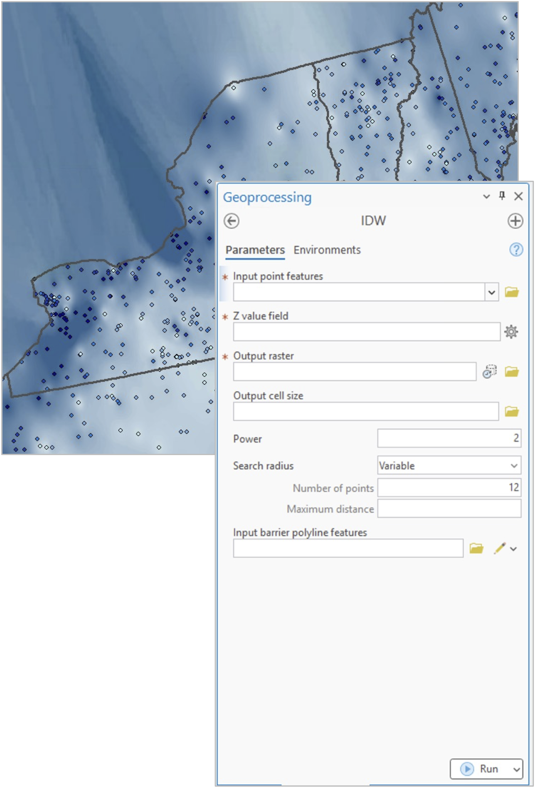{alt="settings" width="70%"}

:::

::::

# Density Estimation

## Density Estimation

- With density estimation, we also start with a set of points
  - These may be simple points (e.g., crime occurrences) or points with data associated with them (e.g., cities with a population attribute)
- In this case, though, we are looking for alternative ways to visualize and measure the density of points
- This can be useful for:
  - Hot spot identification
  - Alternatives to choropleth mapping

## Density Estimation

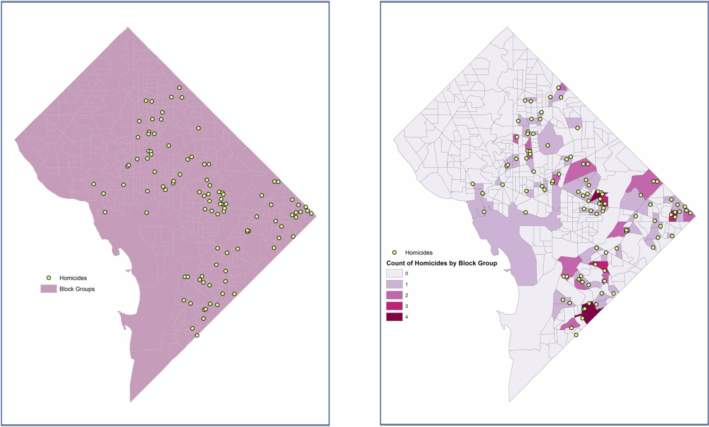{alt="Homicide distribution.jpg"}

## Density Estimation

:::: {.columns}
::: {.column width="50%"}
- Consider the usual case, where we reference counts of occurrences by some spatial unit and/or by area
- Here, the darker the polygon, the higher the point count, which can be problematic:
  - Dependent on choice of spatial unit
  - Assumes that points immediately outside the unit have no impact
- An alternative is to create a surface that estimates the density of points across the study area
- We'll talk about two methods:
  - Point Density
  - Kernel Density Estimation
:::

::: {.column width="50%"}

\
\

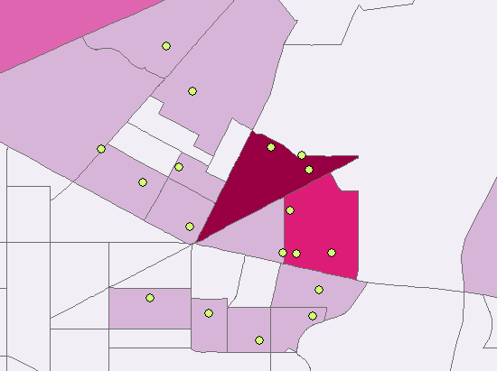{alt="Screenshot of map"}
:::
::::

## Point Density

:::: {.columns}
::: {.column width="50%"}
- The study area is rasterized and each cell is given a neighborhood. We can then count the number of points that fall within the neighborhood for each cell.
- This results in a smooth surface
- In ArcMap, the neighborhood can take various shapes.

:::

::: {.column width="50%"}
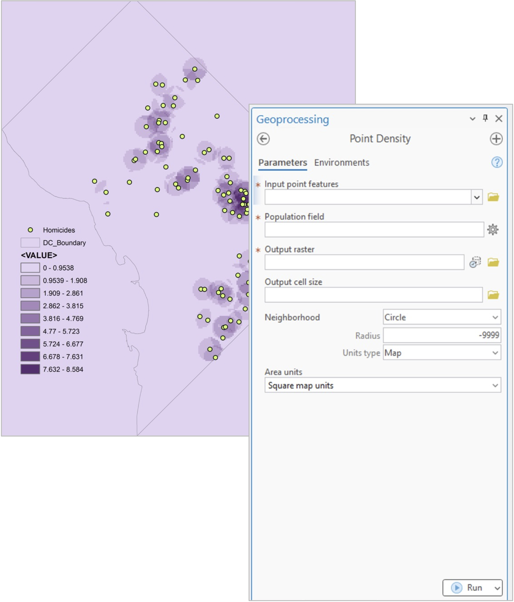{alt="Homicide point density.jpg"}

:::
::::

## Kernel Density

:::: {.columns}
::: {.column width="60%"}
- The issue with regular point density is that each point is weighted equally within the neighborhood
  - Points on the edge of the neighborhood count just as much towards density as points that are located right at the center of the neighborhood
- Kernel density methods place a kernel of a particular shape and of a particular bandwidth over each point and distribute its value across the kernel
- This kernel is like the neighborhood, except that it surrounds the points and distributes their value underneath the curve
  - Cell densities are then the sum of the kernel intersections that occur
:::
::: {.column width="40%"}
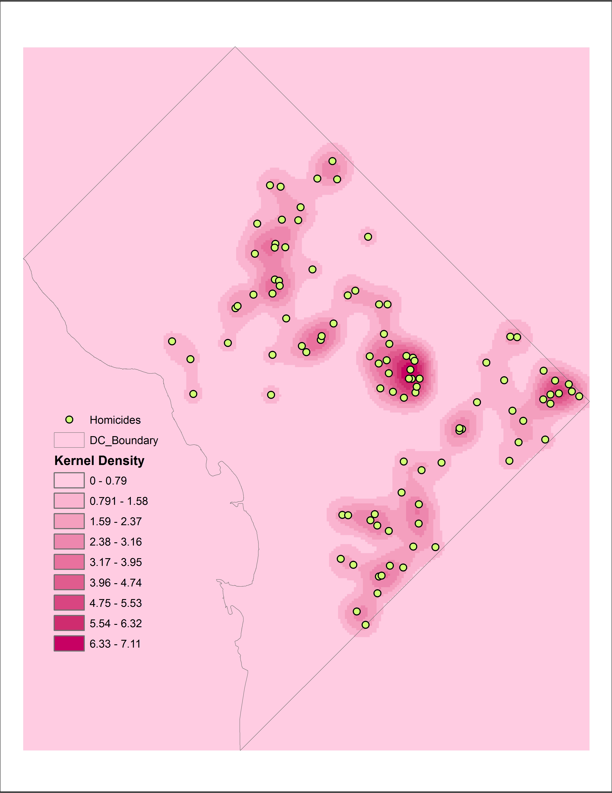{alt="Homicide kernel density small band"}
:::
::::

## Kernel Density

- Results will depend on cell size and bandwidth (or radius)
  - Larger cell sizes will be grainier
  - Larger radii will result in a smoother surface

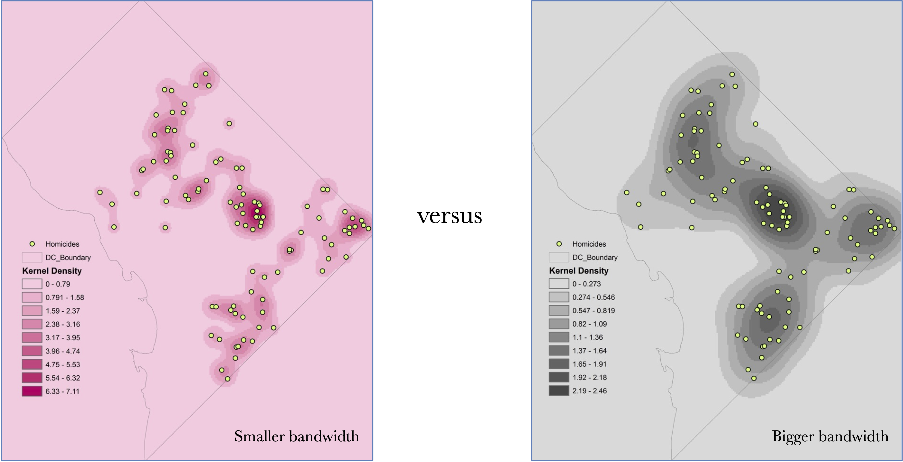{alt="Homicide kernel density small band.jpg"}

## Density estimation

:::: {.columns}
::: {.column width="50%"}
- Things to think about:
  - Cell size
  - Processing environment
  - Bandwidth
  - Kernel function (shape of the kernel)
  - Adaptive v. static bandwidth

:::

::: {.column width="50%"}
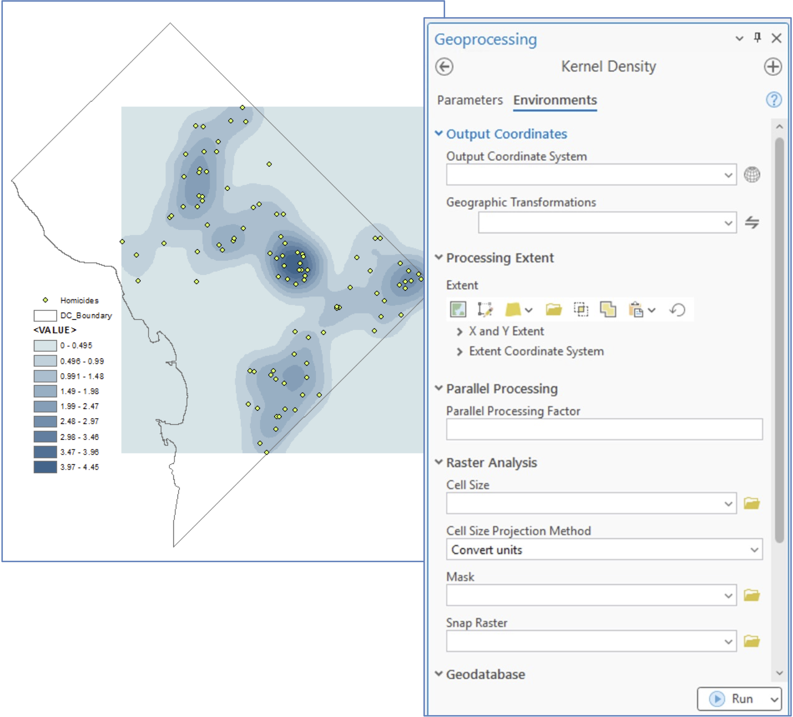{alt=""}
:::
::::

# Hex Maps

## Hex Maps

Pubs and Bars in the UK

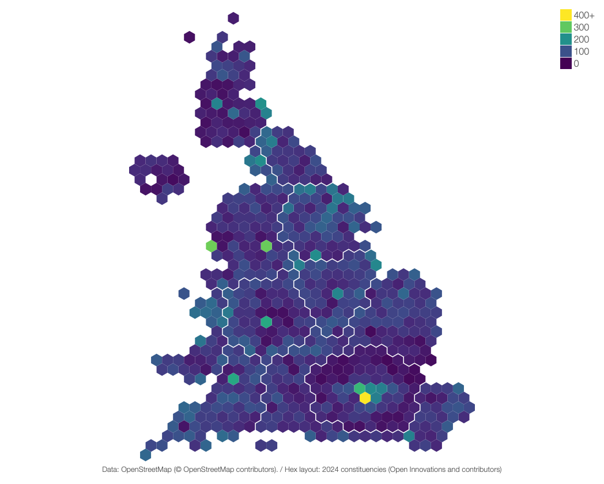{alt="A map of england with hexagons"}

[Source: https://constituencies.open-innovations.org/themes/society/pubs/](https://constituencies.open-innovations.org/themes/society/pubs/)

## Hex Maps…why?

- Lots of advantages
  - Uniform representation of space
  - Deals with problem of irregular polygons
  - Makes it easier to compare densities across units
  - Helps with intuitive distance understanding
- Plus: they just look really cool

## How do we do it?

- Start with count data — points
  - Like people, reported crimes, Airbnbs,…or pubs
- Hexagons (or other regular tessellations, like squares) are simply polygons
  - And we know what to do with points and polygons (count points in polygons and visualize)
- So we just need to know how to create our own polygons

## Creating our own grids/tessellations

- Useful for generating uniform polygons as inputs for spatial joins
- Overcomes shortcomings of administrative geographies which can vary considerably in size
- Also useful for visualizing data in an appealing way
- In ArcGIS Pro: Generate Tessellation (in data Management)
- Lots of choices for size and shape of output polygons (e.g., hexagons, squares, diamonds, triangles)

## Creating our own grids/tessellations

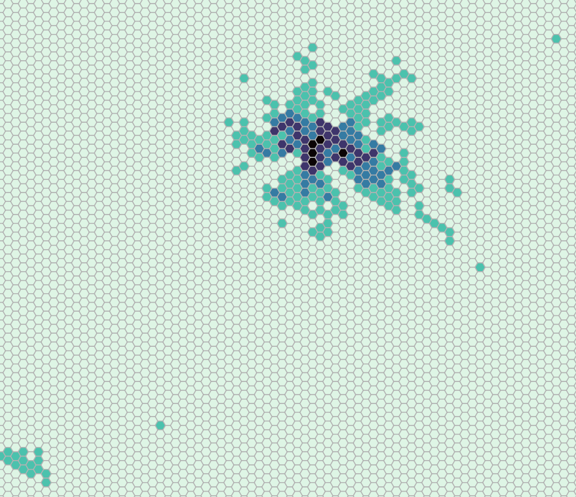{alt="Screenshot of map"}

What could we do to improve this?
