## 

](images/image1.png)

## Today’s agenda

- General housekeeping: Happy Thanksgiving!
- Don't forget poster uploads! Email me with any questions!
- Lecture:
  - Fundamentals basics of optimization and network analysis

## What is Network Analysis?

- Basic:
  - How long will it take me to get from Point A to Point B?
  - What is the shortest path from A to B?
- More complex:
  - If I have 10 errands to run today, what is the most efficient route?
  - If water contamination occurs in one part of the city, which neighborhoods/houses will be affected?
  - What is the closest library to my house? (Note: we already know how to calculate this, using straight-line distance)

## Networks

- A network involves:
  - Movement of something: people, goods, information
  - Transferal of this “something” along designated paths
    - So, different from the way in which we imagine an airplane flying
    - Or a pollutant moving through a body of water or air
- These paths are visualized as lines
  - Roads, power grids, water mains

## Networks versus Lines

- A network is *more* than just lines
  - In our line feature classes, there is no explicit connectivity specified
- So we have to build a network, starting with our lines, e.g. roads

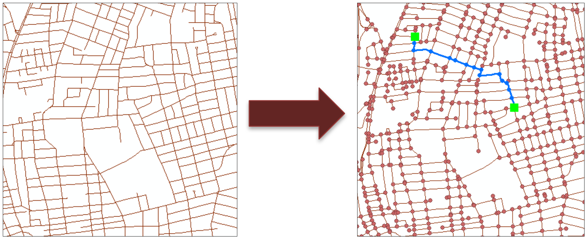{alt="Visual comparison of streets layer and street network"}

## Networks

- Constructed of:
  - Edges: line segments
  - Junctions: intersections
- Both of these can be set as “disabled” or enabled” in a utility network

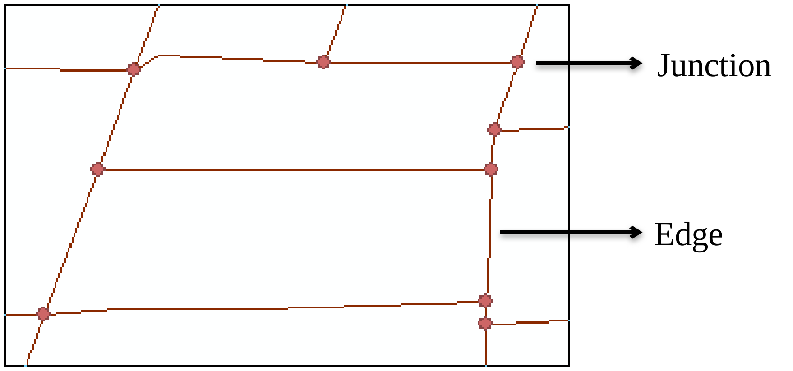{alt="Example of street network"}

## Types of Networks

- Transportation Networks
  - “Undirected” network
  - Traffic/People can travel wherever they like throughout the network
- Utility Networks
  - “Directed” network
  - Flow through the network moves in specified directions
    - Think about water or electricity
  - A “source” introduces material into the network and it travels to a “sink”

## Optimization

- Best location for a set of points
  - “*p-median problem*” – seeking the best location for a set of *p* facilities, such that distance from each point to the closest facility is minimized
    - School location, e.g.
  - “*Coverage problem*” – seeking to minimize the furthest distance traveled
    - Fire station location, e.g.
  - “*Location-Allocation*” – We’re not only trying to locate facilities, but also allocate demand for each facility

## Analysis Considerations

- *Is the goal to maximize coverage?*
  - Seeks to locate facilities such that the furthest distance traveled is minimized or falls within a particular cutoff.
  - Coverage maximization is used when it is important that even the longest distance traveled between demand point and facility meet a particular threshold.
    - Again: Fire station locations
- *Is the goal to minimize total cost or impedance?*
  - This is the p-median problem.
  - Object is to locate facilities such that the total, weighted aggregate travel is minimized.
  - Point of Minimum Aggregate Travel (MAT) minimizes the total burden on demand locations—whether households or businesses.
  - Often used in situations in which public services such as libraries are being located.

## Analysis Considerations

- *Is the goal to locate as few facilities as possible?*
  - Perhaps building the facilities will be expensive. If so, the goal may be to locate as few facilities as possible to still meet coverage requirements.
  - With this option, the GIS will allocate as much demand as possible to the fewest potential locations.
- *Is the goal to secure a certain market share, given the locations of competitors?*
  - This chooses locations with regard to existing competitor locations and seeks to either maximize or ensure a certain market share.
  - Depending on competitor and facility location, a larger or smaller share of the market will be allocated to the potential facilities.
  - The aim of the analysis is to place them such that market share is maximized (or reaches some predetermined threshold).

## More Optimization

- *Service Area* calculation

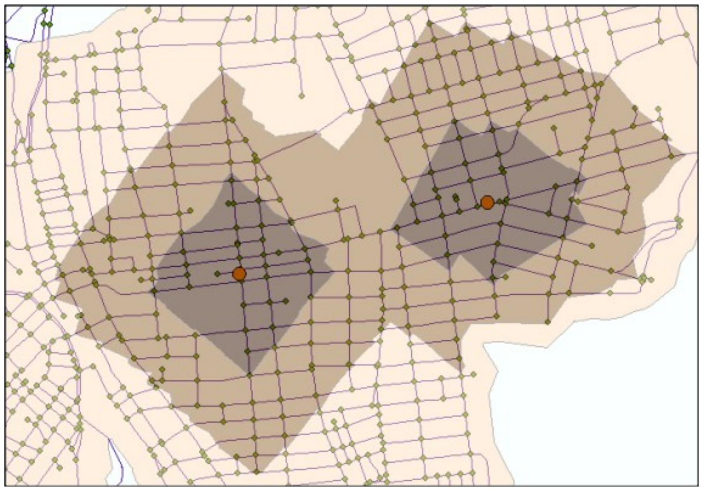{alt="Service area example"}

## Even More Optimization

- Routing on a network
  - “*Shortest path*” – The best path through a network that minimizes distance or travel time
    - Google Maps direction, e.g.

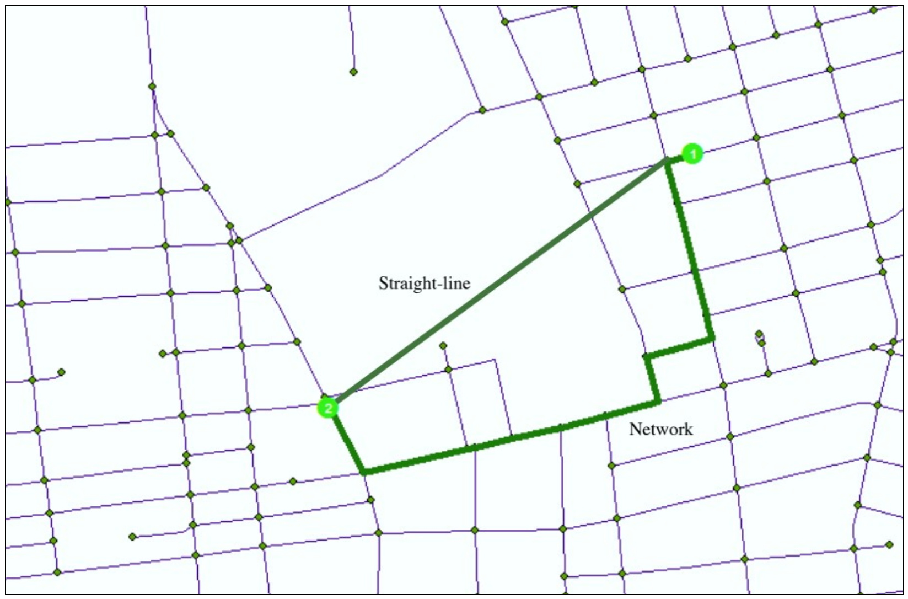{alt="Example of shortest path route"}

## …and Even More Optimization

- “*Traveling Salesman Problem*” (TSP) – Seeks the best ordering of a set of stops to minimize total distance traveled
  - My milkman, e.g.
  - If there are n places to be visited including home base, then there are (n-1)! possible tours to choose from
    - Or, really, (n-1)!/2, since it doesn’t matter if a given tour is done forwards or backwards.
  - Large n problem and the use of heuristics

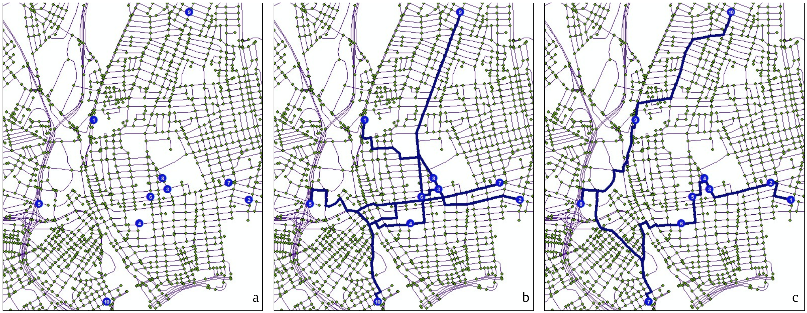{alt="Routing example"}

## Optimization, redux

- Optimum paths - best paths in continuous space
  - Locating highways or power lines, for example
  - Routing airplane flights
- These are often solved using a raster, where each cell contains a *friction* value – cost or time associated with crossing the cell
  - GIS then finds the *least-cost path*
- We can differentiate between optimal locations with a network or just in continuous space

# Network Analysis in ArcGIS Pro

## Lots of Functionality

- **Calculate routes:** shortest route between locations (this is route and distance)
- **Create service areas:** like buffers, except area is calculated based on underlying network
- **Find closest facility:** Identifies the facility, as well as the route to get to it
- **Calculate an origin-destination (O-D) matrix**
- And more!

## Getting Started in ArcGIS Pro

- First off: network analysis is another example of a set of tools that costs credits
  - To make sure you don’t use all your credits up on lab work, this week’s lab is more about exposing you to the possibilities.
- It’s possible to generate your own street network for analysis, but easier to rely on ArcGIS Pro

## Getting Started in ArcGIS Pro

1. Ensure you’re logged into Brown in ArcGIS Pro (should be automatic)
2. Locate “network analysis” in the Analysis tab

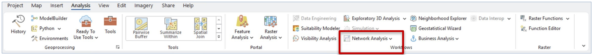{alt="Screenshot of ArcGIS Pro"}

## Getting Started in ArcGIS Pro

::: {.columns}
::: {.column width="45%"}
3. Click on the “Network Analysis” option
   - You should see a range of options appear
4. Clicking on an option will create a set of network analysis layers in your project
:::

::: {.column width="55%"}
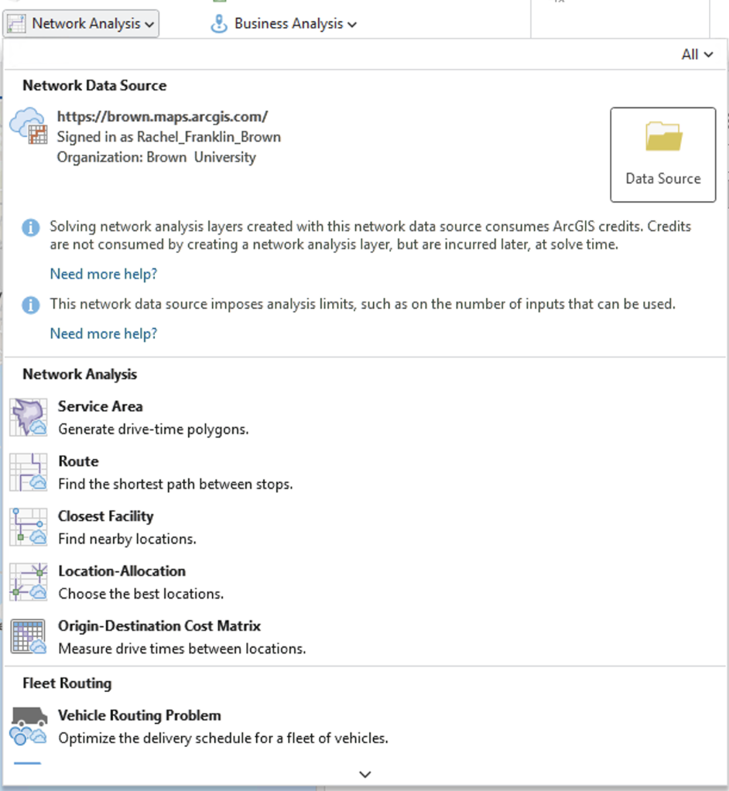{alt="Screenshot of ArcGIS Pro"}
:::
:::

## Routes

::: {.columns}
::: {.column width="45%"}
- You should see a set of empty layers populate your map
- You bring the stops and barriers—that is, these come from your own data or you manually create them
:::

::: {.column width="55%"}
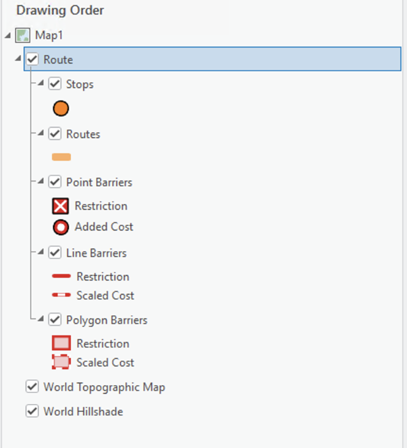{alt="Screenshot of ArcGIS Pro"}
:::
:::

## Routes

- To load stops, click on the “Route Layer” option and Import Stops
  - Note: only import the points that you want to calculate routes for
  - For the lab, for example, you may need to create multiple point layers
  - Routes are calculated in “sequence” order, which is by default the order of locations in your table

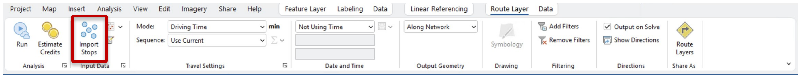{alt="Screenshot of ArcGIS Pro"}

## 

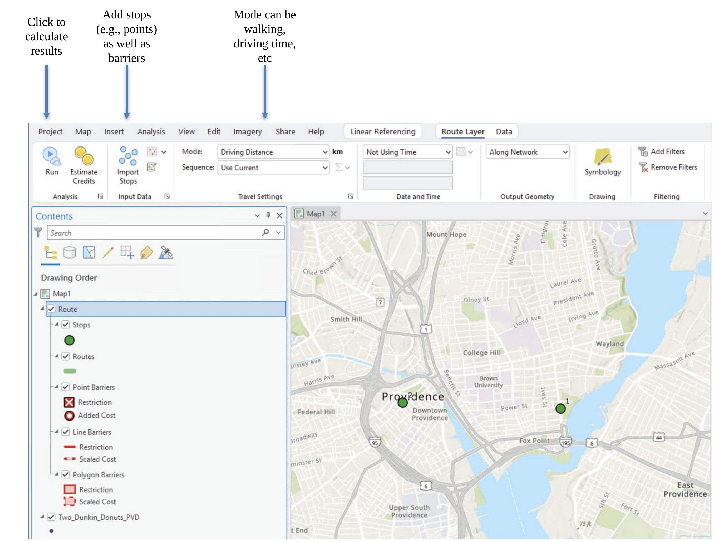{alt="Screenshot of ArcGIS Pro"}

## 

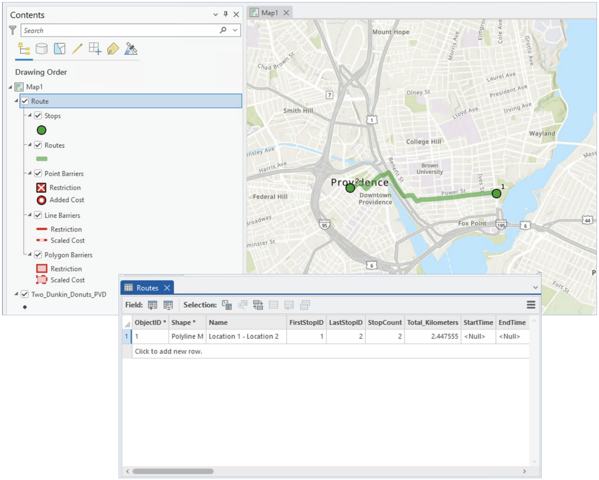{alt="Screenshot of ArcGIS Pro"}

Driving Route and Distance

## How do we deal with multiple stops?

::: {.columns}
::: {.column width="35%"}

\
\

- Default is to calculate route using the “sequence field” in Stops layer
- This calculates route but is not necessarily efficient in terms of stop order!
:::

::: {.column width="65%"}
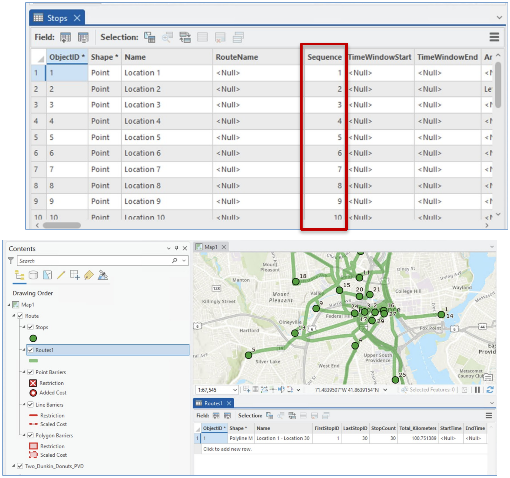{alt="Screenshot of ArcGIS Pro"}
:::
:::

## How do we deal with multiple stops?

::: {.columns}
::: {.column width="35%"}
- Options:
  - Under sequence we can ask the computer to choose a best order for us
    - When we do this, the sequence order is updated in the attribute table
  - Or we can edit the attribute table to reorder the sequence of stops
:::

::: {.column width="65%"}
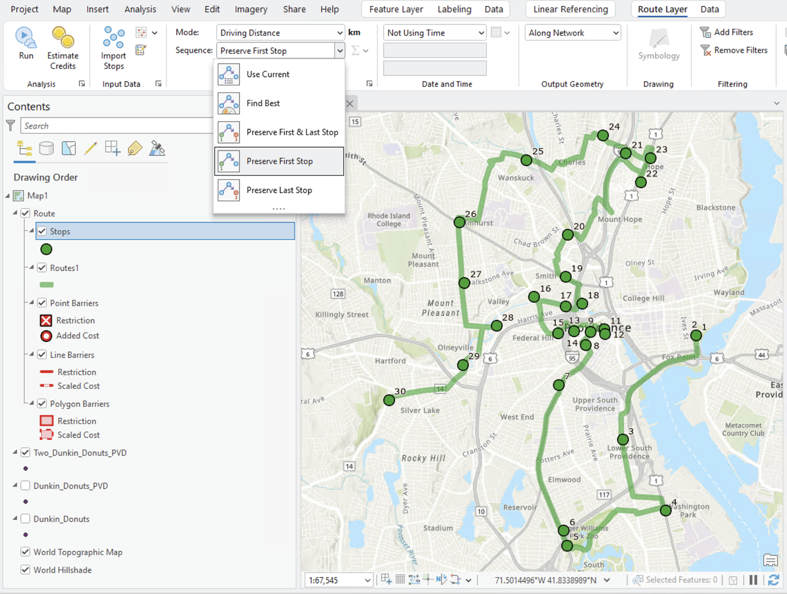{alt="Screenshot of ArcGIS Pro"}
:::
:::

## Service Areas

::: {.columns}
::: {.column width="50%"}
- These are a bit like buffers, but the output polygons reflect network distance, not straight-line distance
  - So, for example, a question like: what share of the population lives within 1km of a Metro station we might prefer a service area to a buffer
:::

::: {.column width="50%"}
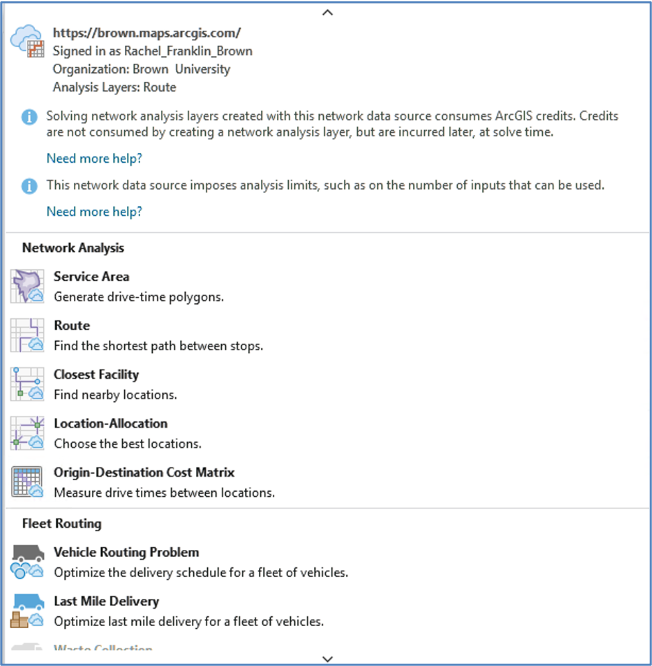{alt="Screenshot of ArcGIS Pro"}
:::
:::

## Service Areas

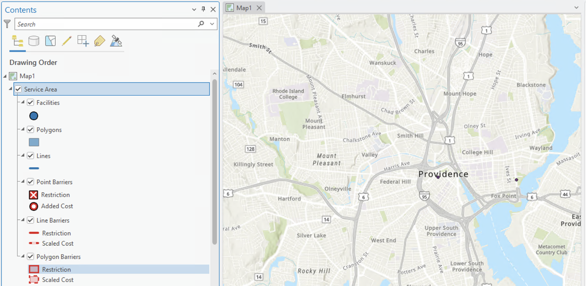{alt="Screenshot of ArcGIS Pro"}

Similar structure to routes

## Service Areas

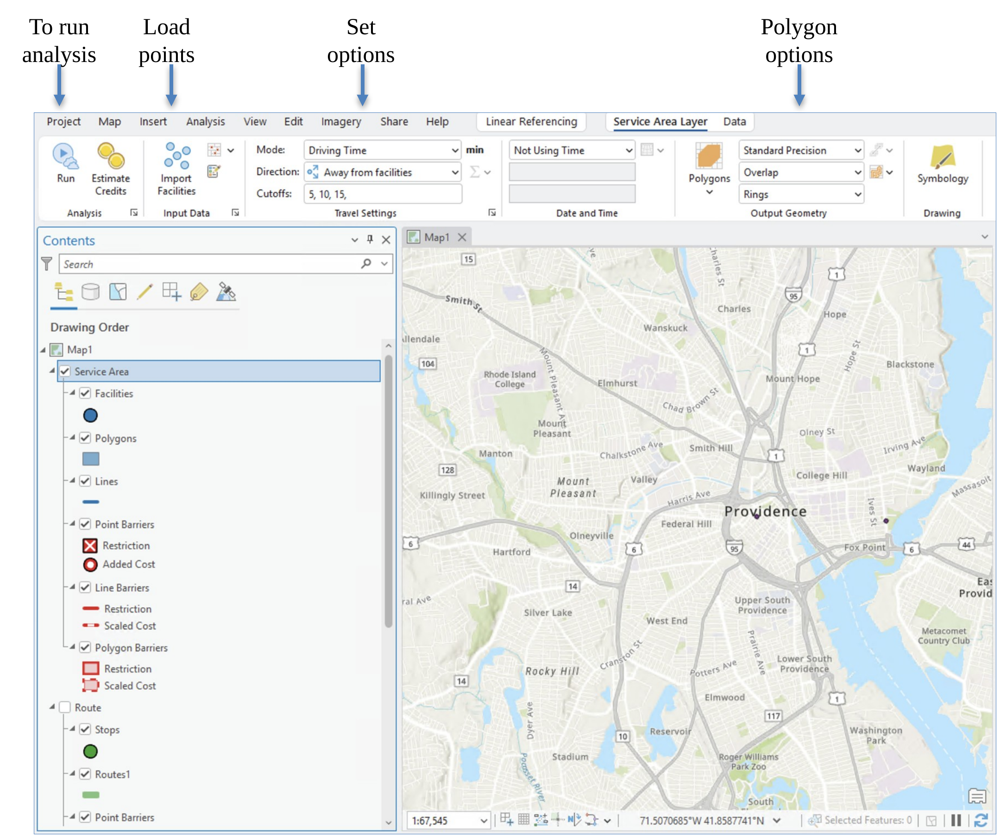{alt="Screenshot of ArcGIS Pro"}

## Service Areas

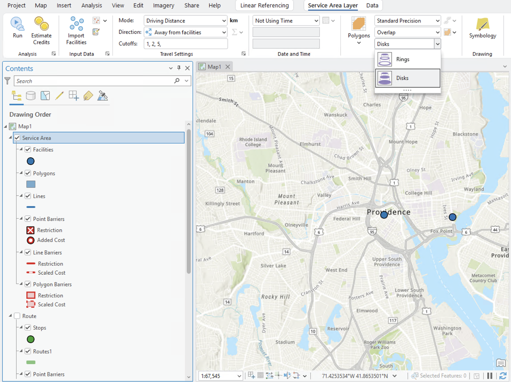{alt="Screenshot of ArcGIS Pro"}

## Service Areas—Results

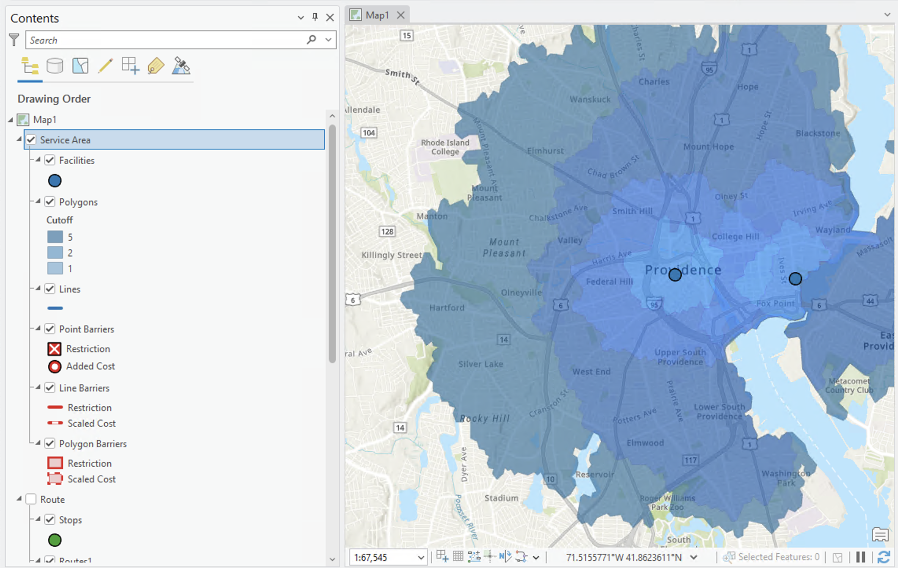{alt="Screenshot of ArcGIS Pro"}

## Service Areas—Results

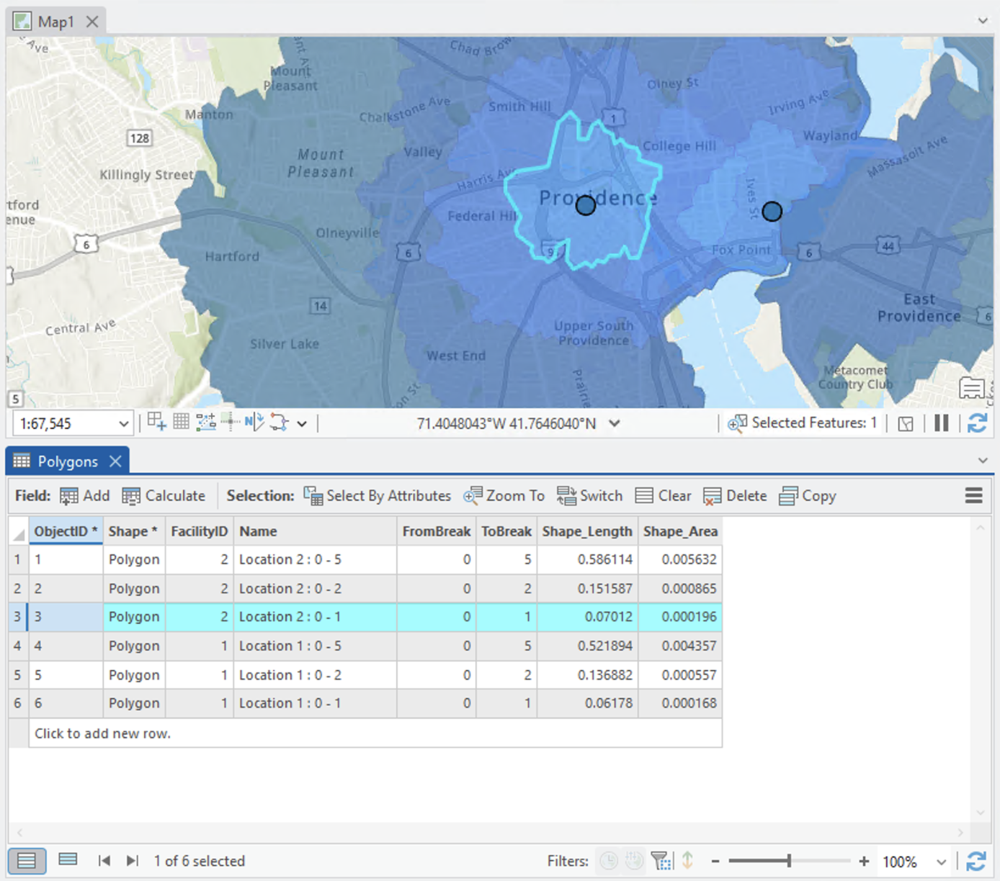{alt="Screenshot of ArcGIS Pro"}

## Network Analysis—Barriers

- When conducting the types of network analysis described above, we can also load or draw barriers into our network – points, streets, or even areas that the calculated route should not use:
  - **Point** barriers can be used to prevent a route using a particular part of a street segment
  - **Line** barriers will block routing anywhere the line crosses
  - **Area** barriers take entire neighborhoods out of play in calculating distances or routes

## How it looks

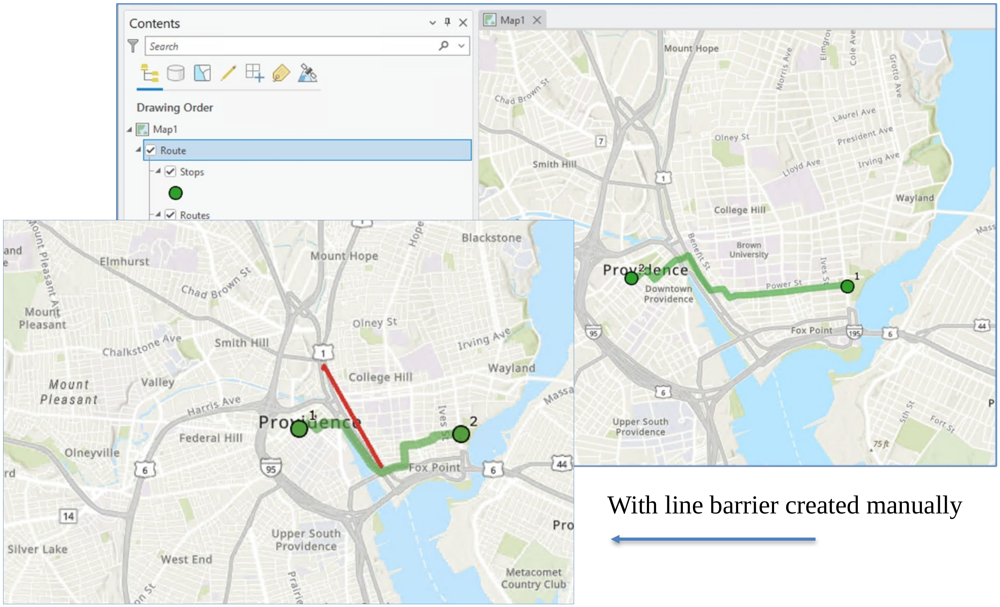{alt="Screenshot of ArcGIS Pro"}

## How it works

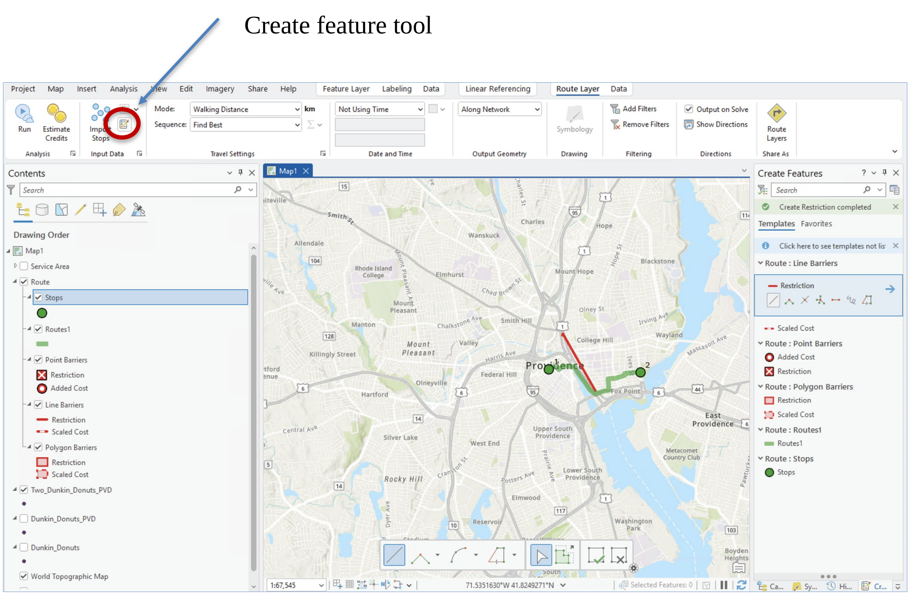{alt="Screenshot of ArcGIS Pro"}

## Things to keep in mind

- You’ll need to specify “cost” – do you want to minimize distance? Time? Is this walking or driving?
- We’re only scratching the surface of functionality
  - There are lots of options available to increase the verisimilitude of networks and the analysis we do with them
